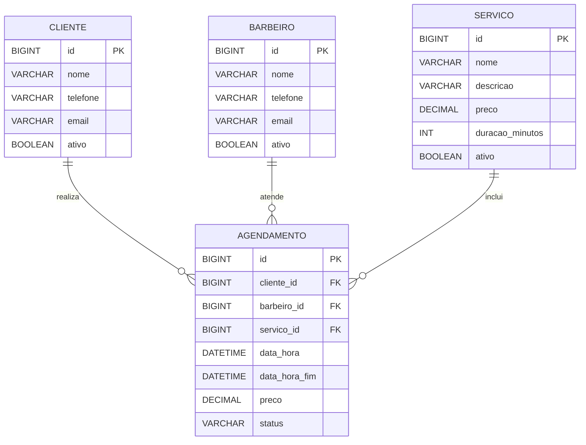

# 💈 ProjetoBarber API


> **Documentação Técnica & Modelo de README do Projeto**  
> API RESTful desenvolvida com Spring Boot para gestão e agendamento de atendimentos em barbearias, contemplando catálogo de serviços, gestão de clientes e barbeiros, prevenção de conflitos de agenda (*double booking*), cancelamentos com antecedência e *soft delete*.

---

## 📑 Sumário

- [1. Visão Geral](#-1-visão-geral)
- [2. O Que Já Foi Implementado](#-2-o-que-já-foi-implementado-histórico-de-evolução)
- [3. Arquitetura e Estrutura do Código](#-3-arquitetura-e-estrutura-do-código)
- [4. Modelagem de Dados & Migrações](#-4-modelagem-de-dados--migrações-flyway)
- [5. Regras de Negócio Implementadas](#-5-regras-de-negócio-implementadas)
- [6. Documentação dos Endpoints (REST API)](#-6-documentação-dos-endpoints-rest-api)
- [7. Tratamento Global de Erros](#-7-tratamento-global-de-erros)
- [8. Testes Automatizados](#-8-testes-automatizados)
- [9. Segurança e Dependências](#-9-segurança-e-dependências)
- [10. Como Executar a Aplicação](#-10-como-executar-a-aplicação)

---

## 💈 1. Visão Geral

O **ProjetoBarber** é uma solução de backend focada no fluxo operacional de barbearias e salões masculinos. O sistema provê serviços para:

- **Clientes**: Cadastro, atualização e listagem com paginação e exclusão lógica (*soft delete*).
- **Barbeiros**: Gestão da equipe de profissionais com controle de disponibilidade.
- **Serviços**: Catálogo com nome, descrição, precificação e duração estimada em minutos.
- **Agendamentos**: Marcação inteligente de horários, cálculo automático de término (`dataHoraFim`), validação contra choques de horário do profissional e política rigorosa de cancelamento.

---

## 🚀 2. O Que Já Foi Implementado (Histórico de Evolução)

Ao longo do desenvolvimento, a aplicação passou por marcos incrementais de arquitetura, domínio e segurança:

1. **Criação do Projeto & Domínio Inicial**:
   - Inicialização com Spring Boot, suporte a Java 21+, Spring Web e Spring Data JPA.
   - Criação das entidades `Cliente` e `Barbeiro` com validação de dados via Bean Validation (`@NotBlank`, `@Email`, `@Size`).

2. **Módulo de Agendamentos**:
   - Criação do modelo `AgendamentoModel` com enum de status (`AGENDADO`, `CANCELADO`, `CONCLUIDO`).
   - Mapeamento de relacionamentos `@ManyToOne` entre `Agendamento`, `Cliente` e `Barbeiro`.

3. **Arquitetura Modular (*Package-by-Feature*)**:
   - Reorganização do projeto para o padrão *Package-by-Feature* (`agendamento`, `barbeiro`, `cliente`, `servico`, `exceptions`), isolando responsabilidades e facilitando a manutenção e escalabilidade.

4. **Padronização de DTOs e Mappers**:
   - Implementação de Records imutáveis para DTOs de entrada (`ClienteDTO`, `BarbeiroDTO`, `ServicoDTO`, `AgendamentoDTO`) e saída (`*ResponseDTO`).
   - Componentes Spring `@Component` dedicados para mapeamento seguro entre entidades e DTOs, evitando o vazamento direto de modelos de persistência na API e prevenindo loops de serialização JSON (`@JsonIgnore`, `@ToString.Exclude`).

5. **Catálogo de Serviços e Soft Delete**:
   - Inclusão do módulo `servico` (corte, barba, combos, etc.) com duração e preço.
   - Adição do atributo `ativo` (`Boolean`) para exclusão lógica em Clientes, Barbeiros e Serviços.
   - Endpoints de listagem equipados com parâmetro `?apenasAtivos=true|false` e suporte nativo a paginação (`Pageable`).

6. **Regras de Negócio e Prevenção de Conflitos (*Double Booking*)**:
   - Cálculo automático do término do atendimento (`dataHoraFim = dataHora + duracaoMinutos`).
   - Bloqueio de agendamento para clientes ou profissionais inativos.
   - Consulta customizada JPQL para evitar sobreposição de horários de um mesmo barbeiro.
   - Limite de apenas 1 agendamento por dia do cliente com o mesmo profissional.
   - Regra de cancelamento com no mínimo 1 hora de antecedência em relação ao horário marcado.

7. **Padronização de Respostas e Tratamento de Exceções**:
   - Controller Advice (`GlobalExceptionHandler`) padronizando mensagens e status HTTP (`400 Bad Request`, `404 Not Found`, `500 Internal Server Error`).
   - Exceções semânticas de negócio: `ResourceNotFoundException` e `BusinessRuleException`.

8. **Versionamento do Banco de Dados com Flyway**:
   - Criação das migrações SQL versionadas:
     - `V1__Create_Tables_Barbeiro_Cliente.sql`
     - `V2__Create_Table_Agendamento.sql`
     - `V3__Create_Table_Servico_And_Alter_Agendamento.sql` (índices de performance e colunas de serviço/soft delete).

9. **Testes Unitários Automatizados**:
   - Criação de testes com JUnit 5 e Mockito em `AgendamentoServiceTest`, garantindo a integridade das regras críticas de agendamento e cancelamento.

10. **Auditoria e Atualização de Segurança**:
    - Análise de vulnerabilidades via Mend.io / Inspeção de Dependências.
    - Atualização explícita no `pom.xml` das versões seguras para `mysql-connector-j` (26.7.0), `tomcat-embed` (11.0.26), `logback` (1.6.3) e `jackson-bom` (3.1.7).

---

## 🏛️ 3. Arquitetura e Estrutura do Código

A aplicação adota o padrão **Package-by-Feature**, onde cada módulo de negócio contém suas entidades, repositórios, serviços, controllers, DTOs e mappers:

```text
src/main/java/dev/vitor/barbearia/ProjetoBarber/
├── ProjetoBarberApplication.java
│
├── agendamento/
│   ├── AgendamentoController.java      # Endpoints REST para agendamento e cancelamento
│   ├── AgendamentoDTO.java             # Record de entrada com validações (@Future, etc.)
│   ├── AgendamentoResponseDTO.java     # Record de resposta customizado
│   ├── AgendamentoMapper.java          # Conversor Model <-> DTO
│   ├── AgendamentoModel.java           # Entidade JPA com relacionamentos e datas
│   ├── AgendamentoRepository.java      # Consultas JPQL de verificação de conflitos
│   ├── AgendamentoService.java         # Regras de negócio de agendamento e cancelamento
│   └── StatusAgendamento.java          # Enum (AGENDADO, CANCELADO, CONCLUIDO)
│
├── barbeiro/
│   ├── BarbeiroController.java
│   ├── BarbeiroDTO.java
│   ├── BarbeiroResponseDTO.java
│   ├── BarbeiroMapper.java
│   ├── BarbeiroModel.java
│   ├── BarbeiroRepository.java
│   └── BarbeiroService.java
│
├── cliente/
│   ├── ClienteController.java
│   ├── ClienteDTO.java
│   ├── ClienteResponseDTO.java
│   ├── ClienteMapper.java
│   ├── ClienteModel.java
│   ├── ClienteRepository.java
│   └── ClienteService.java
│
├── servico/
│   ├── ServicoController.java
│   ├── ServicoDTO.java
│   ├── ServicoResponseDTO.java
│   ├── ServicoMapper.java
│   ├── ServicoModel.java
│   ├── ServicoRepository.java
│   └── ServicoService.java
│
└── exceptions/
    ├── BusinessRuleException.java      # Exceção para violações de negócio (400)
    ├── ResourceNotFoundException.java  # Exceção para recursos não encontrados (404)
    └── GlobalExceptionHandler.java     # @RestControllerAdvice padronizado
```

---

## 🗄️ 4. Modelagem de Dados & Migrações (Flyway)

### Diagrama Entidade-Relacionamento



### Detalhes das Migrações SQL (`src/main/resources/db/migration`):
- **`V1`**: Criação inicial das tabelas `cliente` e `barbeiro`.
- **`V2`**: Criação da tabela `agendamento` com chaves estrangeiras para `cliente` e `barbeiro`.
- **`V3`**: Criação da tabela `servico`, inclusão de `ativo` para soft delete nas entidades base, inclusão de `servico_id`, `data_hora_fim` e `preco` em `agendamento`, além de índices para otimização de buscas de horários (`idx_agendamento_barbeiro_data` e `idx_agendamento_cliente_data`).

---

## ⚖️ 5. Regras de Negócio Implementadas

| Regra | Descrição | Onde está aplicada |
| :--- | :--- | :--- |
| **Entidades Ativas** | Apenas clientes, barbeiros e serviços com `ativo = true` podem participar de novos agendamentos. | `AgendamentoService.agendar` |
| **Limite Diário por Cliente** | Um cliente não pode agendar mais de uma vez no mesmo dia com o mesmo barbeiro. | `AgendamentoRepository.existsByClienteIdAndBarbeiroIdAndDiaLimit` |
| **Anti Double-Booking** | Impede sobreposição de horários para o mesmo barbeiro considerando o intervalo `[dataHora, dataHoraFim]`. | `AgendamentoRepository.existsConflitoHorarioBarbeiro` |
| **Cálculo de Duração & Preço** | O agendamento assume a duração e o preço do serviço selecionado (ou padrão de 30 minutos caso não informado). | `AgendamentoService.agendar` |
| **Cancelamento com Antecedência** | Agendamentos só podem ser cancelados com pelo menos **1 hora** de antecedência do início. | `AgendamentoService.cancelar` |
| **Exclusão Lógica (*Soft Delete*)** | A exclusão de clientes, barbeiros ou serviços altera seu status para `ativo = false`, mantendo a integridade do histórico. | `*Service.excluir` |

---

## 📡 6. Documentação dos Endpoints (REST API)

### ✂️ Clientes (`/api/clientes`)
- `GET /api/clientes` — Lista clientes paginados (Suporta `?apenasAtivos=true|false&page=0&size=10`).
- `GET /api/clientes/{id}` — Busca cliente por ID (`200 OK` ou `404 Not Found`).
- `POST /api/clientes` — Cadastra novo cliente (`201 Created`).
- `PUT /api/clientes/{id}` — Atualiza dados do cliente (`200 OK`).
- `DELETE /api/clientes/{id}` — Desativa o cliente via soft delete (`204 No Content`).

### 💈 Barbeiros (`/api/barbeiros`)
- `GET /api/barbeiros` — Lista barbeiros paginados (Suporta `?apenasAtivos=true|false&page=0&size=10`).
- `GET /api/barbeiros/{id}` — Busca barbeiro por ID.
- `POST /api/barbeiros` — Cadastra novo barbeiro (`201 Created`).
- `PUT /api/barbeiros/{id}` — Atualiza barbeiro.
- `DELETE /api/barbeiros/{id}` — Desativa barbeiro via soft delete (`204 No Content`).

### 🪒 Serviços (`/api/servicos`)
- `GET /api/servicos` — Lista catálogo de serviços paginado (`?apenasAtivos=true|false`).
- `GET /api/servicos/{id}` — Busca serviço por ID.
- `POST /api/servicos` — Cadastra novo serviço no catálogo (`201 Created`).
- `PUT /api/servicos/{id}` — Atualiza serviço.
- `DELETE /api/servicos/{id}` — Desativa serviço do catálogo (`204 No Content`).

### 📅 Agendamentos (`/api/agendamentos`)
- `GET /api/agendamentos` — Lista agendamentos com paginação.
- `POST /api/agendamentos` — Cria um novo agendamento com validações de conflito.
- `PATCH /api/agendamentos/{id}/cancelar` — Cancela o agendamento (respeitando a regra de 1h de antecedência).

---

### Exemplos de Requisições & Respostas

#### 1. Criar um Serviço (`POST /api/servicos`)
**Request:**
```json
{
  "nome": "Corte Degradê + Barboterapia",
  "descricao": "Corte moderno com finalização e toalha quente na barba",
  "preco": 65.00,
  "duracaoMinutos": 45
}
```
**Response (`201 Created`):**
```json
{
  "id": 1,
  "nome": "Corte Degradê + Barboterapia",
  "descricao": "Corte moderno com finalização e toalha quente na barba",
  "preco": 65.00,
  "duracaoMinutos": 45,
  "ativo": true
}
```

#### 2. Criar um Agendamento (`POST /api/agendamentos`)
**Request:**
```json
{
  "clienteId": 1,
  "barbeiroId": 1,
  "servicoId": 1,
  "dataHora": "2026-11-20T14:00:00"
}
```
**Response (`201 Created`):**
```json
{
  "id": 1,
  "clienteId": 1,
  "clienteNome": "João Silva",
  "barbeiroId": 1,
  "barbeiroNome": "Carlos Barbeiro",
  "servicoId": 1,
  "servicoNome": "Corte Degradê + Barboterapia",
  "dataHora": "2026-11-20T14:00:00",
  "dataHoraFim": "2026-11-20T14:45:00",
  "preco": 65.00,
  "status": "AGENDADO"
}
```

---

## 🛡️ 7. Tratamento Global de Erros

As exceções capturadas pelo `GlobalExceptionHandler` devolvem respostas uniformes com carimbo de tempo:

### Violação de Regra de Negócio (`400 Bad Request`):
```json
{
  "timestamp": "2026-10-21T14:50:00.123456",
  "status": 400,
  "error": "Violação de Regra de Negócio",
  "message": "O barbeiro selecionado não está disponível no horário solicitado (conflito de agenda)."
}
```

### Erro de Validação de Campos (`400 Bad Request`):
```json
{
  "timestamp": "2026-10-21T14:50:00.123456",
  "status": 400,
  "error": "Erro de Validação",
  "messages": {
    "dataHora": "O agendamento deve ser para um horário no futuro.",
    "clienteId": "O ID do cliente é obrigatório."
  }
}
```

### Recurso Não Encontrado (`404 Not Found`):
```json
{
  "timestamp": "2026-10-21T14:50:00.123456",
  "status": 404,
  "error": "Recurso não encontrado",
  "message": "Cliente não encontrado com ID: 99"
}
```

---

## 🧪 8. Testes Automatizados

O projeto utiliza **JUnit 5** e **Mockito** para testes unitários focados nas regras de negócio críticas em `AgendamentoServiceTest`:

- ✅ **`deveAgendarComSucesso`**: Garante o cálculo correto do horário de término e persistência do agendamento com todos os vínculos válidos.
- ✅ **`deveLancarExcecaoQuandoConflitoDeHorario`**: Simula colisão de agendamento do barbeiro e verifica o lançamento de `BusinessRuleException` sem salvar no banco.
- ✅ **`deveImpedirCancelamentoComPoucaAntecedencia`**: Valida a recusa de cancelamento com menos de 1 hora de antecedência.

Para executar todos os testes da aplicação:
```bash
./mvnw test
```

---

## 🔒 9. Segurança e Dependências

O gerenciador de dependências (`pom.xml`) possui travas explícitas de versão para garantir que componentes vulneráveis não sejam puxados transitivamente:

| Componente | Versão Fixada | Motivo / Vulnerabilidades Mitigadas |
| :--- | :--- | :--- |
| **`com.mysql:mysql-connector-j`** | `26.7.0` | Mitiga falhas de inspeção de conexão (CVE-2026-60586, CVE-2026-60623, CVE-2026-60624). |
| **`org.apache.tomcat.embed`** | `11.0.26` | Corrige HTTP/2 Request Smuggling e desvio em WebSocket (CVE-2026-86350, CVE-2026-76183, CVE-2026-65637). |
| **`ch.qos.logback:logback-classic`** | `1.6.3` | Elimina risco de Path Traversal no MDC (CVE-2026-19880). |
| **`tools.jackson.core:jackson-bom`** | `3.1.7` | Previne vulnerabilidades de ReDoS e DoS quadrático (CVE-2026-91777, CVE-2026-89407, CVE-2026-68497). |

---

## 💻 10. Como Executar a Aplicação

### Pré-requisitos
- **Java JDK 21** ou superior instalado.
- **Git** instalado.

### Passo a Passo

1. **Clonar o Repositório**:
   ```bash
   git clone https://github.com/seu-usuario/ProjetoBarber.git
   cd ProjetoBarber
   ```

2. **Configuração de Variáveis de Ambiente (Opcional)**:
   Por padrão, a aplicação roda com o banco de dados em memória **H2**, não exigindo banco externo para desenvolvimento e testes.
   Caso deseje conectar ao MySQL, crie um arquivo `.env` na raiz do projeto com as credenciais:
   ```env
   DATABASE_URL=jdbc:mysql://localhost:3306/barber_db
   DB_USERNAME=root
   DB_PASSWORD=suasenha
   ```

3. **Compilar e Rodar**:
   - No Linux/macOS:
     ```bash
     ./mvnw clean spring-boot:run
     ```
   - No Windows (PowerShell / CMD):
     ```powershell
     .\mvnw.cmd clean spring-boot:run
     ```

4. **Acessar o Console H2**:
   - URL: `http://localhost:8080/h2-console`
   - JDBC URL: `jdbc:h2:mem:barber_db_java10x`
   - Usuário: `sa`
   - Senha: *(vazio)*
